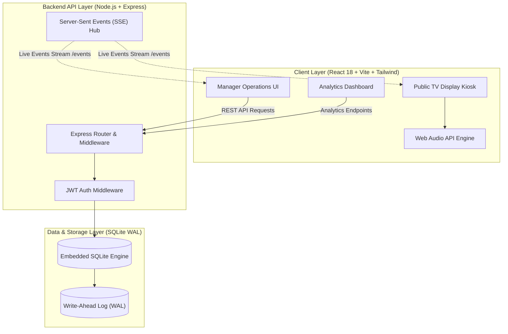
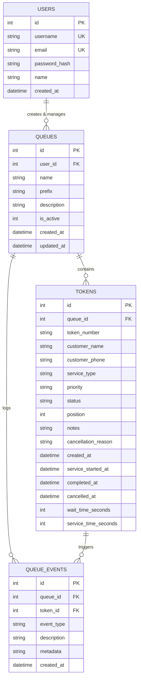
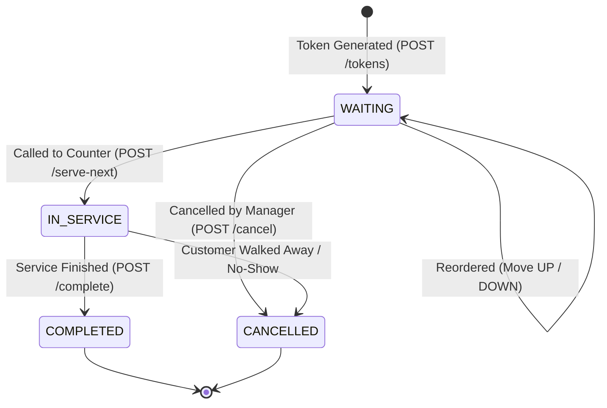

# Rugas QueueFlow — Technical Architecture & Interview Deep-Dive

This document provides a comprehensive technical breakdown of the Rugas QueueFlow system architecture, data models, concurrency control, mathematical formulas for wait time estimation, and preparation questions for technical interviews.

---

## 1. High-Level System Architecture

### Architectural Key Highlights
1. **Decoupled Client & Server with Single-Command Deployment**:
   - The React frontend compiles into `/dist` via Vite.
   - In production, Express hosts both the static frontend and the REST API on a single port (5000), eliminating CORS pre-flight latencies in production.
2. **Native SQLite Engine (`node:sqlite`)**:
   - Uses Node.js 22+ built-in `node:sqlite` (`DatabaseSync`).
   - Zero external binary compilation dependencies (`node-gyp`), ensuring reliable cross-platform execution (macOS, Linux, Docker, Windows).
   - Enabled `PRAGMA journal_mode = WAL;` (Write-Ahead Logging) to allow simultaneous read operations while write transactions are processing.

---

## 2. Database Schema & Entity Relationships

### Table Indexing Strategy
- `idx_tokens_queue_status` on `tokens(queue_id, status)`: Accelerates finding active and waiting tokens.
- `idx_tokens_position` on `tokens(queue_id, position)`: Ensures instant $O(1)$ lookup for the top waiting token (`position = 1`).
- `idx_queue_events_queue` on `queue_events(queue_id, created_at)`: Optimizes timeline and audit feed retrieval.

---

## 3. Token Lifecycle State Machine

A token progresses through strict lifecycle states:

### State Definitions:
- **`WAITING`**: The person is in the lobby queue. Position is strictly $\ge 1$.
- **`IN_SERVICE`**: Assigned to the service desk. Position becomes $0$. `service_started_at` is stamped, and `wait_time_seconds` is permanently logged.
- **`COMPLETED`**: Service ended. `completed_at` is stamped, and `service_time_seconds` is recorded.
- **`CANCELLED`**: Removed from the queue with an audit reason. `cancelled_at` is recorded.

---

## 4. Key Algorithmic Implementations

### A. Queue Reordering Algorithm (Move UP / Move DOWN)
- When a manager clicks **Move Up (↑)** on token $T$ at position $P$:
  1. Boundary check: If $P \le 1$, the token is already at the top. The server rejects the request with HTTP 400.
  2. Locate target token $T_{prev}$ at position $P - 1$.
  3. Execute an atomic swap of the `position` attributes inside a SQLite database transaction.
  4. Call `reindexQueue(queueId)` to guarantee strictly contiguous positions ($1, 2, \dots, N$) with zero gaps.
  5. Broadcast a `QUEUE_REORDERED` event via SSE so all displays update synchronously.
- **Time Complexity**: $O(1)$ for the swap, $O(K)$ for the contiguous re-index where $K$ is the waiting queue length (typically $K < 200$).

### B. Estimated Wait Time Formula (Little's Law Derivative)
In queueing theory (Little's Law: $L = \lambda W$), the estimated waiting time $W_e$ for a token at position $P$ is computed as:

$$W_e = (P - 1) \times \bar{S}$$

Where:
- $P$ is the token's current position rank in the waiting queue ($1, 2, 3 \dots$).
- $\bar{S}$ is the **Exponentially Weighted Moving Average (EWMA)** or cumulative average of completed service durations for that specific queue over the last 20 completed sessions:

$$\bar{S} = \frac{1}{M} \sum_{i=1}^{M} S_i$$

If no prior service data exists, a conservative default of 5 minutes (300 seconds) is used.

---

## 5. Real-Time Synchronization: SSE vs. WebSockets

We selected **Server-Sent Events (SSE)** over WebSockets for this application based on the following engineering trade-offs:

| Parameter | Server-Sent Events (SSE) (Selected) | WebSockets |
|-----------|-------------------------------------|------------|
| **Protocol** | Standard HTTP/1.1 or HTTP/2 | Custom WS handshake upgrade |
| **Data Direction** | Unidirectional (Server $\to$ Client) | Bidirectional (Duplex) |
| **Complexity** | Zero external libraries; native browser `EventSource` | Requires WS client/server libraries, heartbeats, ping/pong frames |
| **Reconnection** | Automatic native reconnection with backoff | Must be manually coded in JS |
| **Firewall / Proxy** | Seamless (Standard HTTPS port 443 / HTTP port 5000) | Often dropped or blocked by corporate proxies |
| **Suitability** | **Ideal**: Actions (clicks) go through REST endpoints; updates broadcast to displays | Overkill for unidirectional update broadcasts |

---

## 6. Technical Interview FAQs (Rugas Interview Preparation)

### Q1: "How do you handle race conditions if two managers try to call the next token at the same second?"
> **Answer**:
> "We protect against race conditions using three complementary layers:
> 1. **Database Level**: SQLite transactions (`DatabaseSync`) operate with serialized writes in WAL mode.
> 2. **State Precondition Check**: The `serve-next` query explicitly filters by `WHERE queue_id = ? AND status = 'WAITING' AND position = 1`. If the first transaction transitions the token to `IN_SERVICE` and position to `0`, the second simultaneous query finds no token at position 1 and receives an error response rather than double-assigning.
> 3. **Contiguous Re-indexing**: Immediate re-indexing shifts the next token up, ensuring position integrity."

### Q2: "How would you scale this architecture to support 100,000 concurrent daily tokens across 50 branches?"
> **Answer**:
> "To scale from a single-node setup to an enterprise distributed deployment:
> 1. **Database Layer**: Transition from embedded SQLite to a managed PostgreSQL cluster with read-replicas for analytics and a primary instance for writes.
> 2. **Queue State Caching**: Use Redis Sorted Sets (`ZSET`) where token IDs are members and positions are sorted scores, allowing $O(\log N)$ position lookups and atomic ranking.
> 3. **SSE Event Bus**: Integrate Redis Pub/Sub so that SSE instances running across multiple Node.js worker nodes can broadcast events to connected client browsers regardless of which node handles the write."

### Q3: "Why did you choose `node:sqlite` instead of an ORM like Prisma or TypeORM?"
> **Answer**:
> "For this full-stack assignment, speed of startup, zero runtime bloat, and reliability across different node versions were paramount. Native `node:sqlite` has zero compilation overhead (unlike native C++ bindings that often fail during `npm install` on different architectures). Furthermore, writing clean SQL statements enabled granular control over indexed subqueries, WAL settings, and windowing functions for analytics without the overhead of ORM abstraction layers."

### Q4: "How does the Public TV Kiosk screen stay in sync when a token is called from the Manager screen?"
> **Answer**:
> "The Public TV Kiosk maintains an open `EventSource` connection to the `/events` endpoint. When the manager clicks 'Call Next Token', the backend finishes the database update and invokes `eventService.broadcast('TOKEN_SERVED', { token })`. The browser's `EventSource` receives the JSON payload, parses the new token details, updates React state, and triggers the Web Audio API synthesis engine to play the two-tone lobby chime."

---

## 7. Progressive Innovations Implemented

To deliver a production-grade, enterprise-ready system that exceeds standard CRUD requirements, the following advanced modules were designed:

1. **AI Queue Copilot & SLA Intelligence**:
   - Continuous velocity analysis ($\lambda$ arrival vs $\mu$ service rate).
   - Automated detection of SLA breaches (> 10 min waiting) with a 1-click **"⚡ Escalate to #1"** priority bypass.
   - Smart staffing heuristics: forecasts congestion surges and recommends counter openings.

2. **Web Speech API Voice Announcements (Text-to-Speech)**:
   - Synthesizes clear audible lobby callouts natively in the browser: *"Token CS-011, Jonathan Doe, please proceed to Counter 1."*
   - Preceded by a Web Audio API two-tone chime (*Ding-Dong*), configurable on/off per screen.

3. **Interactive Drag-and-Drop Reordering**:
   - Complements the Up/Down buttons with standard HTML5 drag-and-drop positional reordering.

4. **Customer Live Mobile Tracker**:
   - Customer-facing smartphone view simulating mobile ticket tracking with real-time SSE progress updates.

5. **Desk Operator Keyboard Accelerators**:
   - Single-key actions (`[Space]` / `[N]` for Call Next, `[C]` for Complete, `[A]` for Add Person) for high-speed counter operations.
